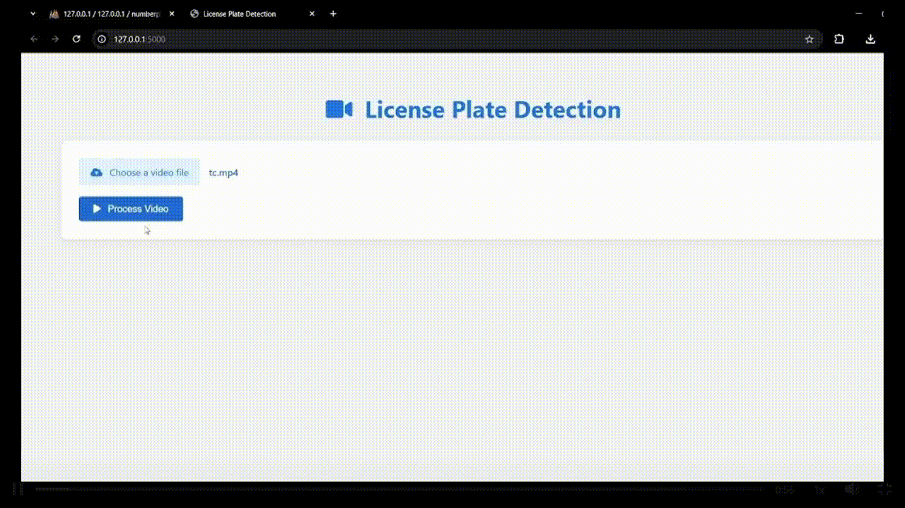

# Car Plate Detection System

[](https://opensource.org/licenses/MIT)
[](https://www.python.org/downloads/)
[](https://opencv.org/)
[](https://github.com/ultralytics/ultralytics)
[](https://github.com/JaidedAI/EasyOCR)

An intelligent computer vision system that detects license plates in uploaded videos and extracts their text. Built with YOLO for plate detection and EasyOCR for text recognition, PlateScope provides a local web interface with confidence scores, video timestamps, and CSV export.

## Features

- **Video Analysis** - Upload common video formats and sample frames for plate detection
- **Plate Detection** - YOLO model trained specifically for license plate detection
- **OCR Integration** - EasyOCR for text extraction
- **Reviewable Results** - Unique plates, OCR confidence, and video timestamps
- **CSV Export** - Download recognized plates for further analysis
- **MySQL Persistence** - Store videos, recognized plates, confidence, and timestamps

## Technology Stack

- **Python 3.10+** - Main programming language
- **Flask** - Local upload and results interface
- **OpenCV** - Computer vision processing
- **Ultralytics YOLO** - Object detection model
- **EasyOCR** - Text recognition
- **MySQL** - Persistent video and plate-result storage
- **NumPy** - Numerical operations
- **Jupyter** - Model training and analysis

## Demo



## Quick Start

```bash
# 1. Install dependencies
.\venv\Scripts\python.exe -m pip install -r requirements.txt

# 2. Copy .env.example to .env and set your MySQL password
Copy-Item .env.example .env

# 3. Create the MySQL database and tables (see MySQL setup below)
# 4. Start the app
.\venv\Scripts\python.exe main.py
```

Open http://127.0.0.1:5000 in your browser.

## Project Structure

```
CarPlate/
├── main.py                    # Main entry point
├── requirements.txt           # Dependencies
├── api/
│   ├── app.py                # Flask routes and upload handling
│   ├── static/css/style.css  # Responsive interface styling
│   └── templates/index.html  # Upload and results page
├── config/
│   ├── settings.py           # Configuration
│   └── class_names.txt       # YOLO classes
├── database/
│   └── schema.sql            # MySQL database schema
├── models/
│   ├── best.pt               # Trained model
│   └── yolo11n.pt           # Base model
├── src/
│   └── plate_detector.py     # Headless detection and OCR pipeline
├── utils/
│   └── database_manager.py   # MySQL persistence and queries
├── .env.example              # MySQL configuration template
├── instance/uploads/         # Local uploaded videos (created at runtime)
├── data/videos/              # Test videos
└── notebooks/
    └── CarPlate.ipynb        # Training notebook
```

## Installation

1. **Clone the repository**
```bash
git clone https://github.com/yourusername/CarPlate.git
cd CarPlate
```

2. **Install dependencies**
```bash
.\venv\Scripts\python.exe -m pip install -r requirements.txt
```

## MySQL setup

1. Install and start **MySQL Server**. In MySQL Workbench, open and execute `database/schema.sql`. Or run it from PowerShell:

   ```powershell
   cmd /c "mysql -u root -p < database\schema.sql"
   ```

2. In the project folder, copy `.env.example` to `.env` and set the credentials for a MySQL user with access to `numberplate`:

   ```powershell
   Copy-Item .env.example .env
   ```

   Edit `.env` and replace `MYSQL_PASSWORD` with your MySQL password. Keep `.env` private; Git ignores it. The MySQL user must be able to create tables and read/write data in `numberplate`.

3. Start MySQL, then run:

   ```powershell
   .\venv\Scripts\python.exe main.py
   ```

   Open http://127.0.0.1:5000. `main.py` checks the MySQL connection and initializes the tables before starting the web server.

## Usage

### Web application

```bash
.\venv\Scripts\python.exe main.py
```

Choose a video and select **Analyze video**. OpenCV processes the video; each analysis and its recognized plates, confidence scores, and timestamps are saved to MySQL. Use **Recent analyses** to reopen saved results. Uploaded video files are stored locally under `instance/uploads/`. The first run may download model or OCR weights. Detection samples one frame in every five by default; change `VIDEO_FRAME_INTERVAL` in `config/settings.py` if needed.

### Command-line detection

```bash
python -m src.plate_detector
python -m src.plate_detector --source "path\to\video.mp4"
```

The command-line entry point prints each unique recognized plate, its confidence, and its timestamp; it does not write results to MySQL.

## Dataset

**Source**: [License Plate Recognition Dataset](https://universe.roboflow.com/roboflow-universe-projects/license-plate-recognition-rxg4e) from Roboflow Universe

### Training Your Own Model

```python
# Download dataset
from roboflow import Roboflow
rf = Roboflow(api_key="your_api_key")
project = rf.workspace("roboflow-universe-projects").project("license-plate-recognition-rxg4e")
version = project.version(11)
dataset = version.download("yolov11")

# Train model
!yolo task=detect mode=train model=yolo11n.pt data={dataset.location}/data.yaml epochs=50 imgsz=640
```

## Configuration

Edit `config/settings.py` to modify model paths, the OCR confidence threshold, and the frame sampling interval. The web app accepts video files up to 500 MB. MySQL connection settings are read from `.env`.

## Contributing

1. Fork the repository
2. Create a feature branch (`git checkout -b feature/new-feature`)
3. Commit your changes (`git commit -m 'Add new feature'`)
4. Push to the branch (`git push origin feature/new-feature`)
5. Open a Pull Request

## License

This project is licensed under the MIT License - see the [LICENSE](LICENSE) file for details.

## Acknowledgments

- [Roboflow Universe](https://universe.roboflow.com/roboflow-universe-projects/license-plate-recognition-rxg4e) - Dataset
- [Ultralytics](https://github.com/ultralytics/ultralytics) - YOLOv11
- [EasyOCR](https://github.com/JaidedAI/EasyOCR) - OCR
  
## 📬 Contact
- **GitHub:** [SaadAbdElGhaffar](https://github.com/SaadAbdElGhaffar)  
- **LinkedIn:** [Saad Abd El-Ghaffar](https://www.linkedin.com/in/saadabdelghaffar/)  
- **Email:** [saad.abdelghaffar.ai@gmail.com](mailto:saad.abdelghaffar.ai@gmail.com)  
- **Kaggle:** [@abdocan](https://www.kaggle.com/abdocan)
